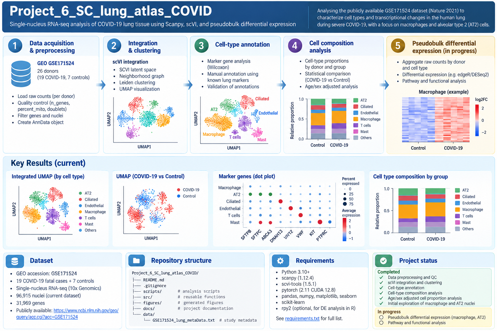

# COVID-19 Lung Atlas — Single-Nucleus RNA-seq Analysis

Analysis of the publicly available [GSE171524](https://www.ncbi.nlm.nih.gov/geo/query/acc.cgi?acc=GSE171524) lung atlas dataset, focusing on cell-type composition and transcriptional changes associated with severe COVID-19, particularly macrophages and alveolar type 2 (AT2) cells.



> **Figure note:** The overview illustration is a schematic summary of the workflow. Embedded UMAPs, dot plots, heatmaps, and bar plots are illustrative and should not be interpreted as the project's actual computed figures.

## Dataset

- **Source:** GEO accession [GSE171524](https://www.ncbi.nlm.nih.gov/geo/query/acc.cgi?acc=GSE171524)
- **Donors:** 26 total — 19 fatal COVID-19 cases and 7 controls
- **Current integrated dataset:** 96,915 nuclei × 31,969 genes
- **Modality:** Single-nucleus RNA sequencing (snRNA-seq)

## Analysis pipeline

| Step | Analysis | Status |
|---|---|---|
| 01 | Data acquisition, nucleus/gene QC, preprocessing | Complete |
| 02 | scVI integration, neighborhood graph, Leiden clustering, UMAP | Complete |
| 03 | Marker-gene analysis and manual cell-type annotation | Complete (annotations provisional) |
| 04 | Donor-level cell-type composition, Mann–Whitney tests, BH-FDR correction, age/sex-adjusted analysis | Complete |
| 05 | Pseudobulk aggregation and differential gene expression | In progress |
| 06 | Functional and pathway analysis | Planned |

## Current findings

The donor-level composition analysis identified differences in recovered cell-type proportions between the COVID-19 and control groups:

| Cell type | COVID-19 median | Control median | BH-adjusted p-value |
|---|---:|---:|---:|
| Macrophage | 25.283% | 6.356% | 0.0180 |
| AT2 | 7.432% | 27.201% | 0.0215 |
| Endothelial-like — unclassified | 2.017% | 1.123% | 0.0215 |

The endothelial-like annotation is provisional. These are **proportions of recovered nuclei**, not estimates of absolute cell abundance. Interpretation is limited by sample size, potential collection/processing confounding, and incomplete postmortem-interval data in controls.

### Pseudobulk QC (in progress)

Pseudobulk samples are defined at the **donor × cell-type** level, with raw gene counts summed across nuclei. The donor, not the nucleus, is the biological replicate.

| Cell type | COVID-19 donors | Control donors | Median nuclei per COVID-19 donor | Median nuclei per control donor |
|---|---:|---:|---:|---:|
| Macrophage | 19 | 7 | 695 | 254 |
| AT2 | 19 | 7 | 208 | 1,033 |

Two COVID-19 donors have only 23 AT2 nuclei each. Pseudobulk library-size and detected-gene QC will inform filtering decisions before differential expression testing. Nonnegative, integer-valued values in `adata.X` are consistent with raw counts; raw-count provenance must also be confirmed from preprocessing.

## Repository structure

```text
Project_6_SC_lung_atlas_COVID/
├── README.md
├── pipeline_overview.png
├── requirements.txt
├── .gitignore
├── scripts/
│   ├── 01_preprocess.py
│   ├── 02_integrate_cluster.py
│   ├── 03_annotate.py
│   ├── 04_cell_composition.py
│   └── 05_pseudobulk.py
├── src/
│   ├── config.py
│   ├── preprocessing.py
│   ├── integration.py
│   ├── annotation.py
│   ├── composition.py
│   └── pseudobulk.py
├── figures/
└── data/
    ├── raw/           # not committed
    ├── processed/     # not committed
    └── results/       # generated analysis outputs
```

## Software

The analysis uses Python, Scanpy, scVI-tools, PyTorch, pandas, NumPy, SciPy, Matplotlib, and related scientific Python libraries. The working environment includes Scanpy 1.12.4, scVI-tools 1.5.1, and PyTorch 2.11 with CUDA 12.8. The exact environment should be exported from the active `sc_covid` conda environment rather than inferred from this README.

## Reproducibility and data availability

Raw sequencing data, processed `.h5ad` objects, and trained model checkpoints are excluded from Git because of their size. The source dataset is publicly available through [GEO GSE171524](https://www.ncbi.nlm.nih.gov/geo/query/acc.cgi?acc=GSE171524). Scripts are organized by analysis stage, with reusable functionality in `src/`.

## Status

**Ongoing project.** Preprocessing, integration, annotation, and cell-type composition analysis are complete. Pseudobulk quality control and differential expression are being developed, followed by functional enrichment analysis.
